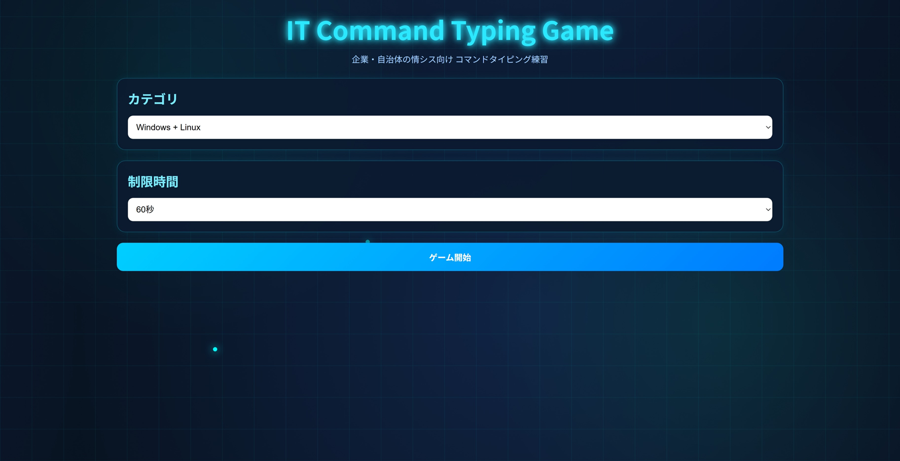
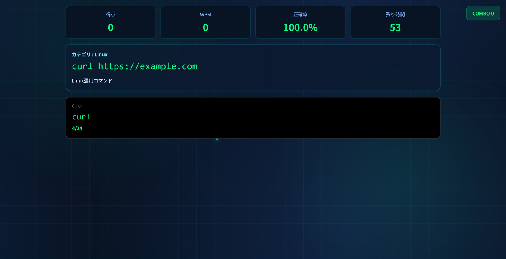
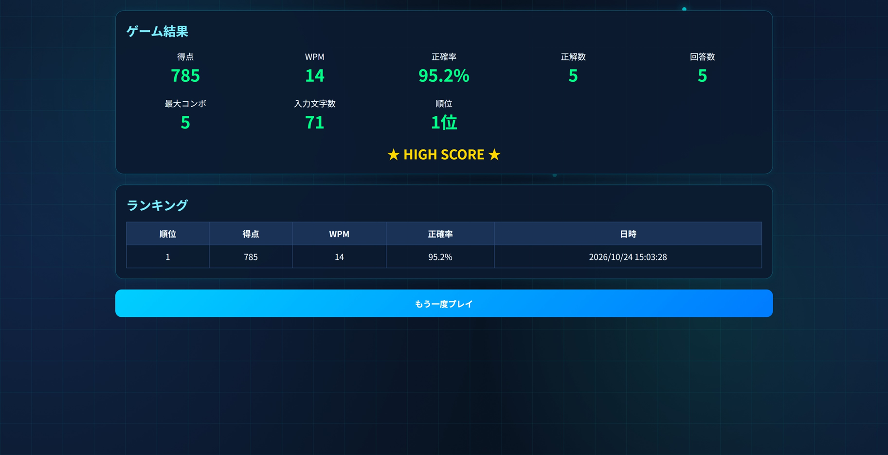

# IT Command Typing Game

企業・自治体・教育機関の情報システム担当者向けに作成した、コマンド入力習熟用のタイピングゲームです。

Windows / Linux の運用現場で頻出するコマンドを使いながらタイピング練習ができます。

[プレイする]()

---

## スクリーンショット

### スタート画面

### プレイ画面

### 結果画面

---

## 特徴

### 実務向けコマンドを採用

以下のような業務でよく使用されるコマンドを多数収録しています。

#### Windows

- ipconfig
- ping
- tracert
- netstat
- tasklist
- robocopy
- gpupdate
- whoami
- systeminfo
- sc query

#### Linux

- ls
- pwd
- df
- free
- ps
- grep
- find
- systemctl
- journalctl
- ssh
- curl

---

### 約300問収録

コマンドだけではなく、

- サーバ名違い
- パス違い
- 共有フォルダ違い
- IPアドレス違い

など類似パターンも含め、実際の運用現場を意識した出題を行います。

---

### ターミナル風UI

- 黒背景
- 等幅フォント
- Enter確定
- Backspace対応
- Delete対応
- カーソル移動対応

実際のターミナル操作に近い感覚で練習できます。

---

### 学習支援

出題ごとに

- カテゴリ
- コマンド
- コマンドの意味

を表示します。

例

|項目|内容|
|---|---|
|カテゴリ|Linux|
|コマンド|systemctl status nginx|
|意味|nginxサービス状態確認|

---

### スコア分析

プレイ結果として以下を表示します。

- 得点
- タイピング速度（WPM）
- 正確率
- 最大コンボ
- 正解数
- 順位

---

### ランキング機能

ブラウザの LocalStorage を利用して記録を保存します。

保存内容

- 得点
- WPM
- 正確率
- 日時

上位10件をランキング表示します。